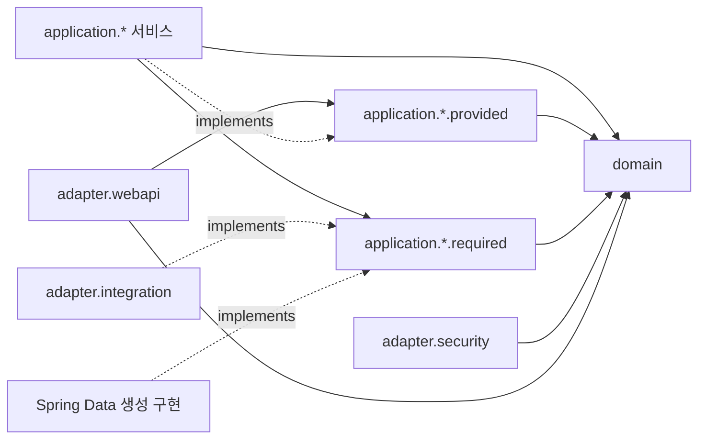

# 아키텍처와 패키지

> 패키지·업무 타입은 샘플 이름이다. 표기 규칙은 [README](README.md)를 따른다. 원본 구현을 설명하는 부분도 이 샘플 이름으로 표기한다.

## 샘플 이름으로 표현한 구조

```text
com.example.app
├── AppApplication
├── domain
│   ├── AbstractEntity
│   ├── account      # Account, AccountDetail, Profile, PasswordEncoder 등
│   ├── author       # Author, AuthorStatus
│   ├── content      # Content, ContentDetail, ContentUpdateInfo 등
│   └── shared       # Email
├── application
│   ├── account
│   │   ├── AccountModifyService / AccountQueryService / AccountAuthenticationService
│   │   ├── provided # AccountRegister, AccountFinder, AccountAuthenticator, 요청 DTO
│   │   └── required # AccountRepository, EmailSender
│   ├── author
│   │   ├── AuthorModifyService / AuthorQueryService
│   │   ├── provided # AuthorApplication, AuthorFinder, 요청·예외
│   │   └── required # AuthorRepository
│   └── content
│       ├── provided # ContentCreator, ContentFinder, ContentPublisher, 요청 DTO
│       └── required # ContentRepository; 서비스 구현은 아직 없음
├── adapter
│   ├── ApiControllerAdvice
│   ├── webapi
│   │   ├── AccountApi
│   │   └── dto      # AccountRegisterResponse
│   ├── integration # DummyEmailSender
│   └── security    # SecurePasswordEncoder
└── support
    └── stereotype  # 계층 의미와 Spring 설정을 묶는 애노테이션
```

원본 개발가이드에 `adapter.persistence`가 제시돼 있지만 실제 소스 디렉터리는 없다. Spring Data가 `required`의 Repository 인터페이스 구현을 생성한다. 단일 모듈이므로 패키지 경계는 주로 코드 규칙과 ArchUnit으로 지킨다.

## 의존성과 실행 흐름

아래 화살표는 **소스 코드의 의존 방향**이다. 런타임에는 application이 required 포트를 호출하고 외부 어댑터 구현이 실행된다.



`AccountApi` → `AccountRegister` → `AccountModifyService` → `Account.register()` → `AccountRepository.save()` → `EmailSender.send()` 순으로 계정 등록을 실행한다. 응답은 `AccountRegisterResponse.of(account)`로 변환한다.

### 계층별 책임

| 위치 | 책임 | 두지 않을 책임 |
| --- | --- | --- |
| `domain.<업무>` | 비즈니스 상태, 값, 상태 전이, 엔티티 불변식 | HTTP 처리, 저장소 조회, 외부 API 호출 |
| `application.<업무>.provided` | 외부에 제공할 유스케이스와 그 입력 계약 | 구현 서비스, HTTP 타입 |
| `application.<업무>.required` | 유스케이스가 요구하는 저장·외부 기능 | 컨트롤러, 비즈니스 상태 전이 |
| `application.<업무>` | 유스케이스 조정, 트랜잭션, 중복 조회, 포트 호출 | HTTP 응답 조립, 어댑터 구현 직접 생성 |
| `adapter.webapi` | HTTP 입력·응답, 상태 코드, DTO 변환 | 엔티티 상태 직접 변경, 저장소 직접 호출 |
| `adapter.integration/security` | required 또는 도메인 인터페이스의 기술 구현 | 다른 업무 유스케이스를 우회하는 변경 |
| `support.stereotype` | 기술적인 공통 애노테이션 | 업무 서비스나 범용 업무 로직 |

## 포트 설계 규칙

**새 프로젝트 규칙**:

1. 서비스부터 만들지 말고 제공할 기능을 `provided` 인터페이스로 정의한다.
2. `AccountRegister`처럼 업무 역할로 이름 붙인다. 모든 서비스에 기계적으로 `Service`/`ServiceImpl` 쌍을 만들지 않는다.
3. 변경·조회 책임을 나눈다. 여러 포트를 한 서비스가 구현할 수 있지만 포트의 기능적 응집성을 유지한다.
4. 같은 업무 또는 다른 업무를 호출할 때 `provided` 포트를 사용한다. 다른 업무의 required 저장소를 직접 끌어오지 않는 것을 기본 규칙으로 한다.
5. required에는 필요한 메서드만 공개한다. 전체 CRUD를 상속해 노출하지 않는다.
6. `PasswordEncoder`처럼 도메인 행위가 필요로 하는 추상화는 도메인에 둘 수 있다. 모든 outbound 인터페이스가 반드시 required에 있어야 하는 것은 아니다.

샘플 명칭으로 표현하면 `AuthorModifyService`는 `AccountFinder`를 통해 계정을 가져온다. `AccountModifyService`는 `AccountFinder`와 `AccountRepository`를 함께 사용한다. 구현 클래스 간 직접 의존은 없다.

## 애그리거트와 업무 간 관계

현재 도메인 의존은 `content → author → account → shared`다. `Content`는 작성자 객체를, `Author`는 계정 객체를 참조한다. ID 참조만 허용하는 모델이 아니다.

- `Account`가 `AccountDetail`을 생성·변경한다. 상세 객체의 변경 메서드는 package-private이다.
- `Content`가 `ContentDetail`을 생성·변경한다. 상세 객체의 변경 메서드도 package-private이다.
- 다른 애그리거트 상태 확인은 `isActive()`, `ensureActive()` 등으로 한다.
- 다른 애그리거트의 상태 변경은 해당 업무 포트에 요청한다.
- 관계에 cascade를 붙일 때는 같은 애그리거트 안인지 확인한다. 계정을 참조하는 작성자를 저장한다고 계정까지 함께 생성·삭제하지 않는다.

현재 ArchUnit은 domain·application 업무 패키지 간 순환 참조와 다른 도메인 슬라이스의 변경 메서드 호출을 검사한다. 다른 슬라이스 메서드 중 `get*`, `is*`, `ensure*`, record·enum 메서드를 허용한다. 이 검사는 메서드명 기반이며 읽기 전용 여부를 증명하지 않는다.

## 프레임워크 의존에 대한 선택

현재 구조를 이식할 때 아래를 허용한다.

- domain: JPA 엔티티 표식, Hibernate 프록시 처리·`@NaturalId`, Lombok, Spring `Assert`, nullability, Jakarta Validation.
- application: Spring 트랜잭션·검증·DI, Spring Data Repository와 JPQL 선언.
- adapter: HTTP, Spring Security 암호화 등 구체 기술.

프레임워크 의존을 더 줄여야 한다면 순수 required 포트와 `adapter.persistence`의 Spring Data 저장소를 분리하고 별도 영속 모델 변환도 검토한다. **이 문서의 기본 구현에서는 그 분리를 자동으로 추가하지 않는다.**

## 새 프로젝트 패키지 템플릿

`com.example.app`은 새 프로젝트 루트로 치환한다. `feature`는 업무 이름으로 치환한다.

```text
src/main/java/com/example/app/
  AppApplication.java
  domain/AbstractEntity.java
  domain/feature/{Feature,FeatureStatus,FeatureCreateInfo}.java
  application/feature/{FeatureModifyService,FeatureQueryService}.java
  application/feature/provided/{FeatureCreator,FeatureFinder,FeatureCreateRequest}.java
  application/feature/required/FeatureRepository.java
  adapter/webapi/FeatureApi.java
  adapter/webapi/dto/FeatureCreateResponse.java
  adapter/ApiControllerAdvice.java
  support/stereotype/*.java
src/main/resources/META-INF/orm.xml
src/test/java/com/example/app/  # 생산 코드의 책임별 구조를 대응시킴
```

원본 소스와 실제 이름은 [원본 분석 기록](08-source-map-and-gaps.md)에서 확인한다.
